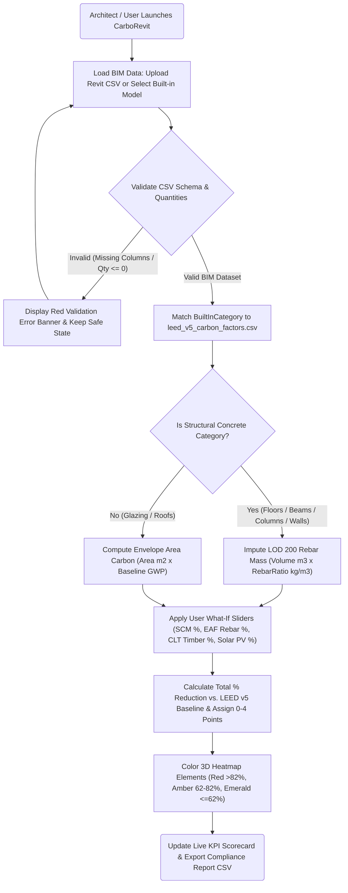
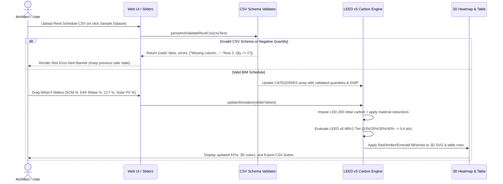

# CarboRevit: Automated LEED v5 Embodied Carbon (MRp2/MRc2) & Green Energy (EAp1/EAc1) Simulator

**Live Deployment URL:** https://marc60809-creator.github.io/CarboRevit  
**Repository:** https://github.com/marc60809-creator/CarboRevit  
**Project Team:** Chu-Shian Tsau (M11513039), Khaing Thinzar (D11513802), Chin-Yi Yang (R14544029)

---

## 1. Project Title
**CarboRevit: An Automated Early-Stage BIM Computational Tool & Interactive Simulator for LEED v5 Embodied Carbon (MRp2/MRc2) and On-Site Renewable Energy (EAp1/EAc1) Assessment**

---

## 2. Project Overview
> Given **an early-stage (LOD 200) Autodesk Revit BIM model or exported Revit category quantity schedule (CSV) together with user-selected decarbonization parameters (SCM concrete %, EAF recycled rebar %, CLT mass timber swap %, and rooftop solar PV coverage %)**, the system **validates the schema and units, imputes missing LOD 200 structural reinforcement weight (`kg/m³`), calculates upfront embodied carbon (LEED v5 MRp2/MRc2 A1–A3) and operational solar PV carbon offset (EAp1/EAc1) against a decoupled CLF/ABRI baseline database**, and produces **a live LEED v5 credit scorecard (0–4 points), a 3D category carbon hotspot heatmap (Red/Amber/Emerald), and an exportable compliance report CSV**.

CarboRevit bridges the gap between schematic BIM modeling (LOD 200) and LEED v5 decarbonization compliance by combining a standalone/pyRevit CLI parser (`revit_plugin/carborevit_leed_v5_cli.py`), a decoupled carbon factor database (`data/leed_v5_carbon_factors.csv`), and an interactive web-based What-If simulator (`index.html`).

---

## 3. Problem / Context
1. **LEED v5 Mandatory Decarbonization Shift:** Under LEED v5 BD+C, quantifying upfront embodied carbon (Stages A1–A3) is mandatory (**MRp2**), and projects earn 1 to 4 credit points (**MRc2**) for achieving 10%, 20%, 30%, or 40% embodied carbon reductions alongside operational carbon and renewable energy tracking (**EAp1/EAc1**).
2. **80% Early-Stage Lock-In vs. Fragmented Excel Workflows:** Roughly 80% of a building's embodied carbon reduction potential is locked in during Schematic Design (LOD 200). Yet current AEC workflows rely on manual schedule exports to Excel and manual EPD lookups that take ~16 hours per iteration, suffer from a ~30% unit/material mismatch rate (`ft³` vs. `m³`), and deliver feedback weeks too late.
3. **Missing 3D Rebar at LOD 200:** Schematic BIM models contain concrete volumes (`m³`) but omit 3D reinforcing steel, which accounts for ~35% of structural RC embodied carbon.

---

## 4. Target User
- **Architects & Architectural Designers** exploring structural and envelope massing schemes during Schematic Design (LOD 200).
- **BIM Coordinators / Structural Engineers** running early quantity takeoffs and low-carbon material swap analyses.
- **LEED AP / Sustainability Consultants** evaluating LEED v5 MRp2/MRc2 and EAp1/EAc1 credit thresholds.

---

## 5. Input
1. **BIM Schedule CSV Input (`data/sample_revit_schedule_*.csv` or User-Uploaded `.csv`):**
   - Required Schema Columns: `BuiltInCategory`, `Unit`, `Quantity`, `MaterialGWP`, `RebarRatio_kg_m3` (plus metadata `ElementId`, `CategoryName`, `FamilyAndType`, `Level`).
   - Supported Revit `BuiltInCategory` values: `OST_Floors`, `OST_StructuralFraming`, `OST_StructuralColumns`, `OST_CurtainWall`, `OST_Walls`, `OST_Roofs`.
2. **Decoupled Baseline Carbon Database (`data/leed_v5_carbon_factors.csv`):**
   - Stores baseline material GWP (`kgCO₂e/m³` or `kgCO₂e/m²`), mass timber alternative GWP, default LOD 200 rebar ratios (`85–150 kg/m³`), and virgin BF (`1.99 kgCO₂e/kg`) vs. recycled EAF (`0.95 kgCO₂e/kg`) rebar factors.
3. **User Interactive What-If Sliders (6 Parameters):**
   - Low-Carbon Concrete SCM (Slag / Fly Ash replacement: `0%–50%`)
   - Recycled Electric-Arc-Furnace (EAF) Rebar share (`0%–100%`)
   - Mass Timber (CLT Slab / Glulam Beam) structural replacement (`0%–70%`)
   - LOD 200 Parametric Rebar Density Factor (`75%–120%`)
   - Recycled Aluminum & Low-E Facade Carbon Cut (`0%–45%`)
   - Rooftop Solar PV Coverage (`0%–85%` of roof area)

---

## 6. Processing / Core Function
1. **Input Schema & Boundary Validation:**
   - Verifies presence of all required CSV columns (`BuiltInCategory`, `Unit`, `Quantity`, `MaterialGWP`, `RebarRatio_kg_m3`).
   - Rejects empty files, unrecognized `BuiltInCategory` identifiers, non-numeric strings, zero/negative quantities (`Quantity <= 0`), and negative GWP or rebar ratios while preserving the last valid application state.
2. **LOD 200 Parametric Rebar Imputation & Upfront Embodied Carbon (A1–A3):**
   - For structural concrete categories ($i \in \{\text{Floors, Beams, Columns, Walls}\}$):
     $$EC_{\text{base}, i} = Q_i \times \left( GWP_{\text{mat}, i} + R_{\text{rebar}, i} \times GWP_{\text{BF}} \right)$$
     $$EC_{\text{prop}, i} = Q_i (1 - \alpha_{\text{CLT}}) \left[ GWP_{\text{mat}, i}(1 - 0.85 \cdot \alpha_{\text{SCM}}) + R_{\text{rebar}, i} \cdot \beta_{\text{dens}} \cdot GWP_{\text{rebar}}(\alpha_{\text{EAF}}) \right] + Q_i \alpha_{\text{CLT}} GWP_{\text{CLT}, i}$$
3. **LEED v5 MRc2 Tier Evaluation:**
   - Computes total percentage reduction $\Delta EC\% = \frac{EC_{\text{base}} - EC_{\text{prop}}}{EC_{\text{base}}} \times 100\%$ and maps to **0 pts** ($<10\%$), **1 pt** ($\ge 10\%$), **2 pts** ($\ge 20\%$), **3 pts** ($\ge 30\%$), or **4 pts** ($\ge 40\%$).
4. **Operational Carbon & Rooftop Solar PV Yield (LEED v5 EAp1/EAc1):**
   - Calculates annual solar generation ($E_{\text{PV}} = A_{\text{roof}} \times \alpha_{\text{PV}} \times 185\text{ kWh/m}^2\text{/yr}$) and net operational carbon using the Taipower grid emission factor ($0.494\text{ kgCO}_2\text{e/kWh}$).
5. **3D Carbon Heatmap Classification (Röck et al., 2018):**
   - Classifies each BIM category by its proposed-to-baseline carbon ratio into **Red Hotspot** ($>0.82$), **Amber Medium** ($0.62–0.82$), or **Emerald Low-Carbon** ($\le 0.62$).

---

## 7. Output
- **Live KPI Scorecard:** Total Upfront Embodied Carbon (`tCO₂e`), Carbon Intensity (`kgCO₂e/m²`), Embodied Carbon Reduction (`%` and `tCO₂e` saved), LEED v5 MRc2 Credit Score (`0–4 Points`), and Operational Carbon + Solar PV Yield (`kWh/yr` & `% offset`).
- **Interactive 3D Carbon Heatmap Preview & Category Breakdown Table:** Real-time Red/Amber/Emerald color-coding of Roof, Walls, Curtain Wall Glazing, Floor Slabs, Beams, and Columns.
- **Exportable LEED v5 Compliance Report (`CarboRevit_LEEDv5_Compliance_Report.csv`):** 1-click CSV download containing category-by-category baseline carbon, proposed carbon, percentage reduction, and heatmap hotspot status.

---

## 8. System Architecture & Diagrams

### A. Workflow Diagram


### B. System Architecture & Data-Flow Diagram

```mermaid
flowchart LR
    subgraph BIM_Layer["BIM Authoring & CLI Layer"]
      R["Autodesk Revit 3D Model (LOD 200)"]
      PY["pyRevit / CLI Script (carborevit_leed_v5_cli.py)"]
      R -- "FilteredElementCollector {ElementId, BuiltInCategory, Volume ft3, Area ft2}" --> PY
    end

    subgraph Data_Layer["Decoupled Carbon Data Layer"]
      DB[("leed_v5_carbon_factors.csv")]
      CSV["Revit Schedule CSV (sample_revit_schedule_*.csv)"]
    end

    subgraph Web_Engine["CarboRevit Web Simulator (index.html)"]
      VAL["CSV Parser & Schema Validator"]
      CALC["LEED v5 A1-A3 & Solar PV Engine"]
      UI["3D SVG Heatmap & KPI Scorecard UI"]
    end

    PY -- "Exports Normalized Metric Schedule {m3, m2, RebarRatio}" --> CSV
    CSV -- "FileReader Upload {CSV Text Rows}" --> VAL
    DB -- "Baseline GWP & Rebar Factors {kgCO2e/unit}" --> CALC
    VAL -- "Validated Category Array {qty, baseMatGwp, rebarRatio}" --> CALC
    CALC -- "Computed Metrics {propTons, redPct, mrc2Pts, heatColorHex}" --> UI
    UI -- "Blob Download {CarboRevit_LEEDv5_Compliance_Report.csv}" --> U("Architect / LEED Consultant")
```


### C. Runtime Sequence Diagram


---

## 9. Technology Stack
- **Frontend & Interactive Web Simulator:** HTML5, Tailwind CSS, Vanilla ES6 JavaScript, Dynamic SVG 3D Isometric Heatmap, Mermaid.js v10 (live diagram rendering), HTML5 `FileReader` & `Blob` CSV I/O.
- **BIM & Command-Line Verification Script:** Python 3 / pyRevit (`revit_plugin/carborevit_leed_v5_cli.py`) compatible with Autodesk Revit API (`FilteredElementCollector`, `BuiltInCategory`, `OverrideGraphicSettings`).
- **Decoupled Data Layer:** Local CSV carbon factor database (`data/leed_v5_carbon_factors.csv`) based on Carbon Leadership Forum (CLF v2026), Taiwan ABRI, and Taipower grid emission factors.
- **Hosting & Version Control:** Git & GitHub Pages (`https://marc60809-creator.github.io/CarboRevit`).

---

## 10. Installation / Setup Instructions

### Option A: Live Web Application (Zero Installation)
Open the deployed GitHub Pages portal directly in any browser:  
👉 **https://marc60809-creator.github.io/CarboRevit**

### Option B: Run Locally
```bash
git clone https://github.com/marc60809-creator/CarboRevit.git
cd CarboRevit
# Open index.html in any modern browser, or start a local HTTP server:
python -m http.server 8080
```

### Option C: Run the Python CLI / pyRevit Verification Script
```bash
# Verify with the valid 8-story RC office schedule:
python revit_plugin/carborevit_leed_v5_cli.py data/sample_revit_schedule_8story_rc.csv

# Verify with the 12-story commercial tower schedule:
python revit_plugin/carborevit_leed_v5_cli.py data/sample_revit_schedule_12story_tower.csv

# Test input validation error handling with the corrupted schedule:
python revit_plugin/carborevit_leed_v5_cli.py data/sample_invalid_schedule_for_testing.csv
```

---

## 11. How to Use the Application
1. **Page 1 (`🎛️ Interactive Carbon Simulator`):**
   - Click **🏢 Load 8-Story RC Sample** or **🏙️ Load 12-Story Tower CSV**, or click **📤 Upload Revit CSV** to upload any custom CSV schedule from the `data/` folder.
   - Click **⚠️ Test Invalid CSV (Error State)** to verify how the application catches missing schema columns and negative quantities without crashing.
   - Drag the **6 Early-Stage What-If Decarbonization Sliders** (or click the **Baseline / Tier 1 / Tier 2 / Max Decarbonization** preset buttons) to see real-time updates to the LEED v5 points, 3D Carbon Heatmap, and category table.
   - Click **⬇️ Export LEED v5 Report (.CSV)** to download the compliance report.
2. **Page 2 (`📄 English Research Proposal PDF`):** View or download the full Master's Research Proposal (`.PDF` and `.DOCX`).
3. **Page 3 (`📽️ Simple 15-Slide Presentation`):** Present the project in-class using keyboard arrow keys (`←` / `→`) with bilingual speaker notes.
4. **Page 4 (`🛠️ Stage 2 & Final Tech Design Review`):** Inspect the live Mermaid Workflow, Architecture/Data-Flow, and Sequence diagrams, MVP scope, Technical Risks, and AI Development Record.

---

## 12. AI / Agent Development Record

### AI Tools Used
- **Google Antigravity Coding Agent** & LLM-assisted coding workflows.

### Task Division (Delegated vs. Student-Directed)
- **Tasks Delegated to AI:** Generating responsive Tailwind CSS dashboard layouts, scaffolding client-side CSV `FileReader` parsing and `Blob` export functions, and formatting Mermaid.js system diagrams.
- **Student-Directed Tasks:** Defining the LEED v5 BD+C (MRp2, MRc2 10%–40% tiers, and EAp1/EAc1) domain logic, compiling Taiwan ABRI and CLF baseline carbon factors (`leed_v5_carbon_factors.csv`), formulating the LOD 200 parametric rebar imputation ratios (`85–150 kg/m³`), and validating calculations against our 8-story RC office building benchmark.

### Significant AI Error Discovered, Verified, and Corrected
1. **What the AI Initially Proposed:** In an early prototype of the BIM volume-to-carbon calculation engine, the AI calculated structural concrete carbon using only `Volume × Concrete_GWP` and directly multiplied raw Revit internal volume units without converting cubic feet (`ft³`) to cubic meters (`m³`).
2. **How the Problem Was Discovered:** When testing the 8-story RC office building case study (`4,800 m²` GFA), the initial formula produced unrealistic carbon totals that differed drastically from our manual Excel takeoff benchmark (`1,248.4 tCO₂e`).
3. **How the Student Verified the Issue:** We inspected the Revit API `HOST_VOLUME_COMPUTED` documentation (confirming Revit stores internal volumes in `ft³` where `1 ft³ = 0.0283168 m³`) and calculated the missing reinforcement contribution, verifying that unmodeled rebar at LOD 200 represents ~35% of structural RC embodied carbon.
4. **How the Issue Was Corrected:** We explicitly added unit conversion constants (`FT3_TO_M3 = 0.0283168466`) in `revit_plugin/carborevit_leed_v5_cli.py` and added the parametric LOD 200 rebar imputation term (`qty * rebarRatio * Rebar_GWP`) to both the Python script and the JavaScript simulation engine in `index.html`.

---

## 13. Known Limitations
1. **Lifecycle Boundary (A1–A3 & Operational EAp1):** The current MVP evaluates upfront product-stage embodied carbon (Stages A1–A3) for the 6 primary structural and envelope categories (>80% of total building embodied carbon) plus rooftop solar PV operational carbon offset. Maintenance/replacement (Stages B1–B5), end-of-life (C1–C4), and MEP systems are excluded.
2. **Parametric Rebar Estimation at LOD 200:** Because 3D rebar is not modeled during Schematic Design, rebar mass is imputed using empirical structural ratios (`kg/m³`). Detailed structural shop drawings at LOD 400 are required for final fabrication sign-off.
3. **Static Offline Carbon Baseline CSV:** Uses a curated offline CSV database (`data/leed_v5_carbon_factors.csv`) for reliability and speed rather than querying live cloud EPD endpoints during slider interaction.

---

## 14. Future Development
- **Cloud EC3 API Integration:** Connect directly to the BuildingTransparency EC3 REST API to fetch manufacturer-specific regional EPDs in real time.
- **Compiled C# .NET DockablePane Add-In:** Package the WPF C# prototype into a signed `.msi` installer for Autodesk Revit 2025/2026 with automated Shared Parameter write-back.
- **Whole-Life Carbon (Stages A–C) & Cost Pareto Optimization:** Expand calculation coverage to include construction transport (A4–A5), replacement cycles (B4), and multi-objective cost vs. carbon Pareto front optimization.
