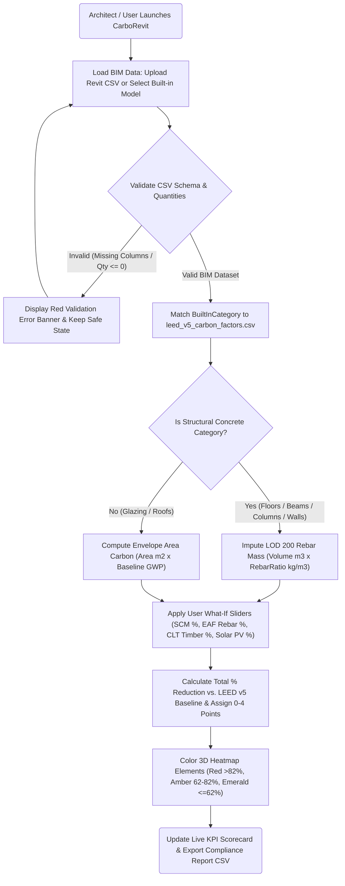
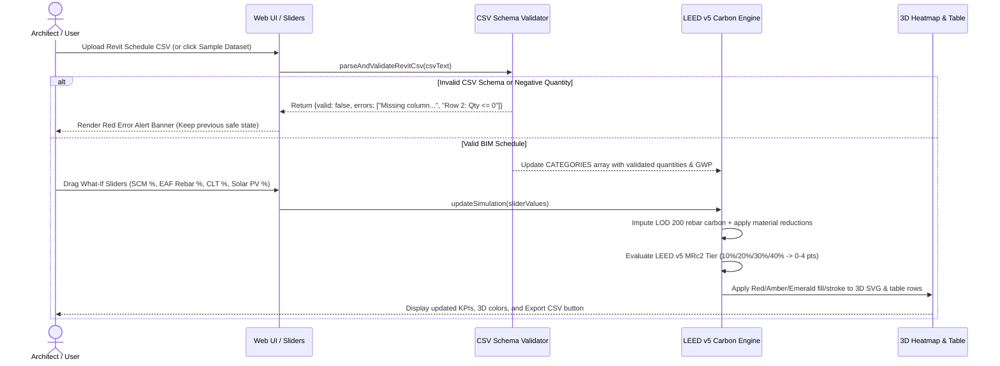

# Stage 2 — Technical Design Review: CarboRevit

**Project Title:** CarboRevit: Automated LEED v5 Embodied Carbon & Green Energy Simulator  
**Live Prototype / MVP URL:** https://marc60809-creator.github.io/CarboRevit  
**Team Members:** Chu-Shian Tsau (M11513039), Khaing Thinzar (D11513802), Chin-Yi Yang (R14544029)

---

## 1. The Finalized Task

> Given **an early-stage (LOD 200) Autodesk Revit BIM model or exported Revit category quantity schedule (CSV) together with user-selected decarbonization parameters (SCM concrete %, EAF recycled rebar %, CLT mass timber swap %, and rooftop solar PV coverage %)**, the system **validates the schema and units, imputes missing LOD 200 structural reinforcement weight (`kg/m³`), calculates upfront embodied carbon (LEED v5 MRp2/MRc2 A1–A3) and operational solar PV carbon offset (EAp1/EAc1) against a decoupled CLF/ABRI baseline database**, and produces **a live LEED v5 credit scorecard (0–4 points), a 3D category carbon hotspot heatmap (Red/Amber/Emerald), and an exportable compliance report CSV**.

---

## 2. The Proposed Workflow (Diagram A)

The workflow diagram below illustrates the end-to-end activities, user inputs, schema/quantity validation decisions, alternative error paths, and outputs:

---

## 3. System Architecture & 4. Data Flow (Diagram B)

The system architecture and data-flow diagram below specifies all components and the exact payload transferred across every arrow:

```mermaid
flowchart LR
    subgraph BIM_Layer["BIM Authoring & CLI Layer"]
      R["Autodesk Revit 3D Model (LOD 200)"]
      PY["pyRevit / CLI Script (carborevit_leed_v5_cli.py)"]
      R -- "FilteredElementCollector {ElementId, BuiltInCategory, Volume ft3, Area ft2}" --> PY
    end

    subgraph Data_Layer["Decoupled Carbon Data Layer"]
      DB[("leed_v5_carbon_factors.csv")]
      CSV["Revit Schedule CSV (sample_revit_schedule_*.csv)"]
    end

    subgraph Web_Engine["CarboRevit Web Simulator (index.html)"]
      VAL["CSV Parser & Schema Validator"]
      CALC["LEED v5 A1-A3 & Solar PV Engine"]
      UI["3D SVG Heatmap & KPI Scorecard UI"]
    end

    PY -- "Exports Normalized Metric Schedule {m3, m2, RebarRatio}" --> CSV
    CSV -- "FileReader Upload {CSV Text Rows}" --> VAL
    DB -- "Baseline GWP & Rebar Factors {kgCO2e/unit}" --> CALC
    VAL -- "Validated Category Array {qty, baseMatGwp, rebarRatio}" --> CALC
    CALC -- "Computed Metrics {propTons, redPct, mrc2Pts, heatColorHex}" --> UI
    UI -- "Blob Download {CarboRevit_LEEDv5_Compliance_Report.csv}" --> U("Architect / LEED Consultant")
```

---

## 5. One Important Runtime Sequence (Diagram C)

The sequence diagram below traces the runtime execution when a user uploads or selects a Revit schedule CSV, including the alternative error condition path when invalid data is encountered:

---

## 6. Interface & Interaction Design

Our interface is implemented as a responsive dark-mode engineering dashboard (`index.html`) designed around clarity, visual hierarchy, immediate user feedback, and explicit error states:

1. **Top Navigation & Preset Bar:** Lets users switch between the Interactive Carbon Simulator (Page 1), English Research Proposal PDF (Page 2), 15-Slide Presentation Deck (Page 3), and Stage 2 Technical Design Review Diagrams (Page 4), or apply 1-click LEED v5 credit presets (`Baseline 0 pt`, `Tier 1 1 pt`, `Tier 2 2 pts`, `Max Decarbonization 4 pts`).
2. **BIM Schedule CSV Import & Validation Alert Banner:**
   - **Success State (Emerald Banner):** Confirms the number of validated Revit category records loaded and updates GFA and roof area automatically.
   - **Error State (Red Banner):** Triggered when uploading a malformed CSV or clicking `⚠️ Test Invalid CSV (Error State)`. Lists exact row numbers and missing column names while preserving the current working dataset.
3. **KPI Scorecard & LEED v5 Tier Gauge:** Displays Upfront Embodied Carbon (`tCO₂e`), `% Reduction`, earned LEED v5 MRc2 Points (`0–4`), and Solar PV offset (`kWh/yr`), paired with a progress bar marked at the 10%, 20%, 30%, and 40% thresholds.
4. **2-Column Interactive Workspace:**
   - **Left Column:** 6 What-If Decarbonization Sliders with live unit/percentage readouts.
   - **Right Column:** Interactive 3D Isometric Carbon Heatmap (`Red` Hotspot / `Amber` Medium / `Emerald` Low-Carbon) and a `FilteredElementCollector` Category Breakdown Table.

---

## 7. Selected Technology Stack

| Layer | Technology | Justification |
| :--- | :--- | :--- |
| **Interactive Web UI & Visualizations** | HTML5, Tailwind CSS, Vanilla ES6 JS, Dynamic SVG, Mermaid.js | Zero-install browser execution on GitHub Pages with instant `<10ms` slider recalculation and 3D SVG color updates. |
| **BIM / CLI Script** | Python 3 / pyRevit (`revit_plugin/carborevit_leed_v5_cli.py`) | Supports both inside-Revit execution and standalone CLI CSV verification without requiring a Revit license on the grading machine. |
| **Decoupled Data Storage** | CSV (`data/leed_v5_carbon_factors.csv` & `data/sample_revit_schedule_*.csv`) | Enforces Content-Presentation Decoupling so regional GWP factors (CLF / Taiwan ABRI) can be updated without modifying application code. |

---

## 8. Working Proof-of-Concept (PoC)

Both the web application and the Python CLI verification script are fully functional:
- **Web PoC (`index.html`):** Supports uploading custom Revit CSV schedules, switching between the 8-Story RC Office (`4,800 m²`) and 12-Story Commercial Tower (`10,200 m²`) datasets, testing invalid CSV input handling, adjusting 6 live decarbonization sliders, viewing the 3D Carbon Heatmap, and exporting `CarboRevit_LEEDv5_Compliance_Report.csv`.
- **Python CLI PoC (`revit_plugin/carborevit_leed_v5_cli.py`):** Validates CSV input schemas from the command line and outputs LEED v5 baseline vs. proposed carbon totals and credit points.

---

## 9. Proposed Minimum Viable Product (MVP) vs. Extended Goals

### Required MVP Features (Completed)
- Upload and validate a Revit schedule CSV file (`BuiltInCategory,Unit,Quantity,MaterialGWP,RebarRatio_kg_m3`) with clear error feedback for invalid or missing data.
- Automatically impute LOD 200 reinforcing steel carbon (`kg/m³`) for structural concrete elements.
- Provide interactive What-If sliders for low-carbon concrete (SCM %), recycled EAF rebar %, mass timber (CLT) replacement %, rebar density, facade carbon reduction, and rooftop solar PV coverage.
- Display real-time LEED v5 MRc2 points (`0–4 pts`), EAp1/EAc1 solar PV offset, a 3D Carbon Heatmap (`Red/Amber/Emerald`), and export the processed compliance report to CSV.

### Extended Goals (Future Work)
- Live OAuth API integration with the cloud BuildingTransparency EC3 database.
- Compiled C# .NET WPF DockablePane installer (`.dll` / `.addin`) for Autodesk Revit 2025/2026.
- Whole-life carbon assessment covering Stages B1–B5 (maintenance/replacement) and Stages C1–C4 (deconstruction/end-of-life).

---

## 10. Major Technical Risks and Limitations

1. **LOD 200 Missing 3D Reinforcement Risk:** Schematic BIM models lack modeled 3D rebar (~35% of structural carbon). *Mitigation:* Impute empirical rebar density (`85–150 kg/m³`) by category and expose Slider #4 (`75%–120%`) for structural sensitivity testing.
2. **Inconsistent Revit Family Naming & Unit Mismatches:** Different firms name families differently and Revit stores internal volume in `ft³`. *Mitigation:* Anchor mapping to standard `BuiltInCategory` enums (`OST_Floors`, `OST_StructuralColumns`, etc.) and validate metric quantities on CSV import.
3. **Scope Boundary Limitation:** The MVP targets the top 6 structural and envelope categories (>80% of upfront embodied carbon) rather than MEP equipment or interior finishes.
